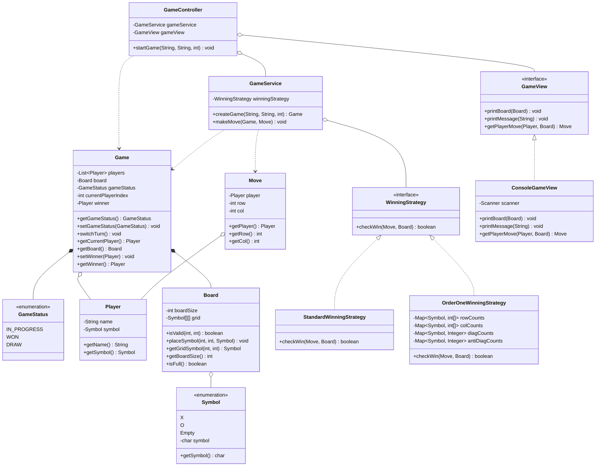

# Tic-Tac-Toe — Low-Level Design (Machine Coding)

A production-grade, object-oriented implementation of the classic Tic-Tac-Toe game designed for Machine Coding interviews (Flipkart, Uber, Swiggy, PhonePe, Razorpay, Cred).

---

## Table of Contents
1. [Problem Statement & Requirements](#problem-statement--requirements)
2. [Architecture Overview](#architecture-overview)
3. [Class Diagram](#class-diagram)
4. [Package & Directory Structure](#package--directory-structure)
5. [Key Design Patterns & SOLID Principles](#key-design-patterns--solid-principles)
6. [Component Details](#component-details)
7. [Time & Space Complexity](#time--space-complexity)
8. [Extensibility & Interview Follow-ups](#extensibility--interview-follow-ups)
9. [How to Run](#how-to-run)

---

## Problem Statement & Requirements

### Functional Requirements:
- Support an `N x N` board size (configurable at runtime).
- Support 2 players with assigned symbols (`X` and `O`).
- Support turn-based play until a win condition or draw condition is met.
- Validate every move (reject out-of-bounds cells and already-occupied cells).
- Render board status to the console after each move.
- Announce the winner or declare a draw when the board is full.

### Non-Functional Requirements:
- Clean Object-Oriented Design: Proper separation of concerns across Domain, Service, Controller, and View.
- Extensible & Maintainable: Follow SOLID principles (pluggable win strategies, decoupled I/O).
- Stateless Service: Service classes must avoid state pollution and be thread-safe.
- Encapsulation: Domain models must protect internal data structures from external mutation.

---

## Architecture Overview

The system follows the MVC (Model-View-Controller) pattern layered with a Strategy Pattern for rule validation:

```
                  ┌──────────────────────┐
                  │      Main.java       │
                  └──────────┬───────────┘
                             │ (wires dependencies)
                             ▼
                  ┌──────────────────────┐
                  │    GameController    │
                  └─────┬──────────┬─────┘
                        │          │
         (drives view)  │          │ (delegates game actions)
                        ▼          ▼
     ┌────────────────────┐      ┌─────────────────────────┐
     │  GameView (I/O)    │      │       GameService       │
     │  (ConsoleGameView) │      └────────────┬────────────┘
     └────────────────────┘                   │
                                              │ (evaluates moves)
                                              ▼
                                 ┌─────────────────────────┐
                                 │     WinningStrategy     │
                                 │  - StandardWinning (O(N)│
                                 │  - OrderOneWinning (O(1)│
                                 └────────────┬────────────┘
                                              │
                                              ▼
                                 ┌─────────────────────────┐
                                 │      Domain Models      │
                                 │   Game, Board, Player,  │
                                 │   Move, Symbol, Status  │
                                 └─────────────────────────┘
```

---

## Class Diagram



---

## Package & Directory Structure

```
src/tictactoe/
├── Main.java                              # Composition root & entry point
├── controller/
│   └── GameController.java                # Orchestrates the game flow loop
├── service/
│   └── GameService.java                   # Core domain orchestrator (stateless)
├── view/
│   ├── GameView.java                      # Presentation contract (Interface)
│   └── ConsoleGameView.java               # Terminal CLI implementation
├── strategy/
│   ├── WinningStrategy.java               # Strategy contract for win verification
│   ├── StandardWinningStrategy.java       # O(N) row/col/diagonal win check
│   └── OrderOneWinningStrategy.java       # O(1) count-based win check
└── domain/
    ├── Board.java                         # Board matrix state & cell validations
    ├── Game.java                          # Match state, turn tracking, status
    ├── Player.java                        # Immutable player identity & symbol
    ├── Move.java                          # Value object capturing player's move
    └── enums/
        ├── GameStatus.java                # IN_PROGRESS, WON, DRAW
        └── Symbol.java                    # X, O, Empty
```

---

## Key Design Patterns & SOLID Principles

### 1. Strategy Pattern (Behavioral)
- Interface: `WinningStrategy`
- Implementations:
  - `StandardWinningStrategy`: `O(N)` row, column, and diagonal inspection using `board.getGridSymbol()`.
  - `OrderOneWinningStrategy`: `O(1)` constant-time checking using frequency tables (`rowCounts`, `colCounts`, `diagCounts`, `antiDiagCounts`).
- Benefit: Pluggable rules without editing `GameService`.

### 2. Dependency Inversion Principle (DIP)
- `GameController` depends on the `GameView` interface, not on a concrete terminal `Scanner` or `System.out`.
- Switching from a CLI console to a Desktop GUI or Web API requires zero changes to the controller or service.

### 3. Single Responsibility Principle (SRP)
- `Board`: Manages cell grid storage and boundary bounds checking.
- `Game`: Manages player list and match state transitions.
- `GameService`: Manages move orchestration and invokes strategy checks.
- `GameView`: Manages user input reading and visual formatting.
- `GameController`: Manages loop flow, catching exceptions, and status termination.

### 4. Encapsulation & Information Hiding
- `Board` does not expose its raw 2D array (`Symbol[][]`).
- Callers must use `board.getGridSymbol(row, col)`, preventing unauthorized external modification.

### 5. Stateless Service Design
- `GameService` does not hold any transaction-specific fields (no `currentPlayer`, no `row`, no `colFlag`).
- All move computations are stack-allocated local variables, making the service thread-safe and reusable across concurrent games.

---

## Component Details

### `Board.java`
- Initializes an `N x N` board filled with `Symbol.Empty`.
- Provides `isValid(row, col)` to verify coordinates are within range and not already occupied.
- Provides `placeSymbol(row, col, symbol)` to update a cell.
- Provides safe inspection via `getGridSymbol(row, col)`.

### `Game.java`
- Tracks the active game status (`IN_PROGRESS`, `WON`, `DRAW`).
- Rotates turns via `switchTurn()`.
- Maintains winner reference when status transitions to `WON`.

### `GameService.java`
- Factory method `createGame(...)` creates players and board.
- `makeMove(Game game, Move move)` executes move validation, cell marking, win evaluation, draw check, and turn switching.

### `ConsoleGameView.java`
- Reads 0-indexed row and column integers from `Scanner`.
- Renders the board grid neatly with space delimiters.
- Displays game announcements and prompts.

---

## Time & Space Complexity

| Operation | Standard Strategy | Order(1) Strategy | Space Complexity |
| :--- | :--- | :--- | :--- |
| Move Validation | `O(1)` | `O(1)` | `O(1)` |
| Move Placement | `O(1)` | `O(1)` | `O(1)` |
| Win Checking | `O(N)` | `O(1)` | `O(1)` for Standard, `O(N)` memory for Order(1) |
| Draw Checking (`isFull`) | `O(N^2)` scan | `O(N^2)` scan | `O(1)` |
| Board Display | `O(N^2)` | `O(N^2)` | `O(1)` |

---

## Extensibility & Interview Follow-ups

### 1. How to Support an AI / Bot Player?
- Pattern: Strategy Pattern + Factory Pattern.
- Create `BotPlayer extends Player` containing a `BotPlayingStrategy`.
- `BotPlayingStrategyFactory.getStrategy(BotDifficultyLevel)` returns:
  - `EasyBotPlayingStrategy`: Picks first available empty cell.
  - `HardBotPlayingStrategy`: Minimax algorithm.
- Follows Liskov Substitution Principle (LSP): `BotPlayer` can be added to `game.getPlayers()` seamlessly.

### 2. How to Implement "Undo" Move?
- Pattern: Command Pattern.
- Inside `Game`, maintain a `Deque<Move> moveHistory`.
- On `undo()`:
  1. Pop the last move.
  2. Set `board.placeSymbol(row, col, Symbol.Empty)`.
  3. Revert turn index.
  4. If using `OrderOneWinningStrategy`, decrement the respective count table.

### 3. How to Support K-in-a-row on an M x N Board (Gomoku / Connect-4)?
- Implement a new `KInARowWinningStrategy implements WinningStrategy`.
- From `(lastRow, lastCol)`, radiate outward in 4 directions (horizontal, vertical, both diagonals) and count contiguous matching symbols.
- If count is at least K, declare win in `O(K)` time.

### 4. How to Handle Multi-threaded / Network Play?
- Synchronize move execution per `gameId` using a `ReentrantLock` or `synchronized(game)`.
- Enforce turn ownership: `if (move.getPlayer() != game.getCurrentPlayer()) throw new InvalidPlayerException();`.
- Use optimistic locking with `@Version` in database persistence layers.

---

## How to Run

### Compile
From the project root:
```bash
javac -d bin src/tictactoe/**/*.java src/tictactoe/*.java
```

### Run
```bash
java -cp bin src.tictactoe.Main
```

### Sample Console Interaction
```
Enter Player 1 name:
Alice
Enter Player 2 name:
Bob
Enter Board Size:
3
Empty Empty Empty 
Empty Empty Empty 
Empty Empty Empty 
Alice with Symbol X, please enter row and column number of your move:
0 0
X Empty Empty 
Empty Empty Empty 
Empty Empty Empty 
Bob with Symbol O, please enter row and column number of your move:
1 1
...
Game is won by Player Alice
```
